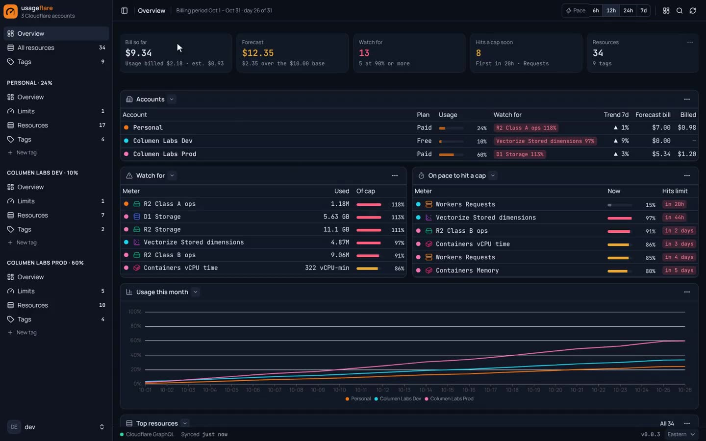
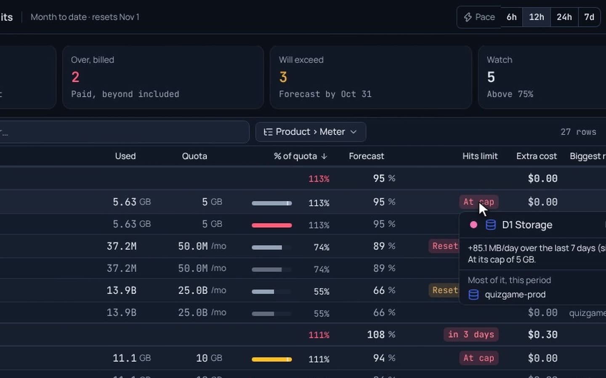
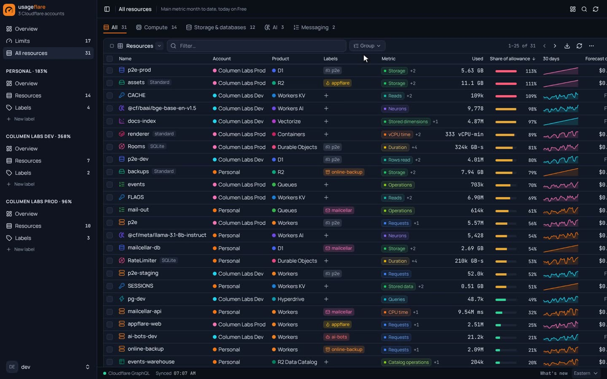
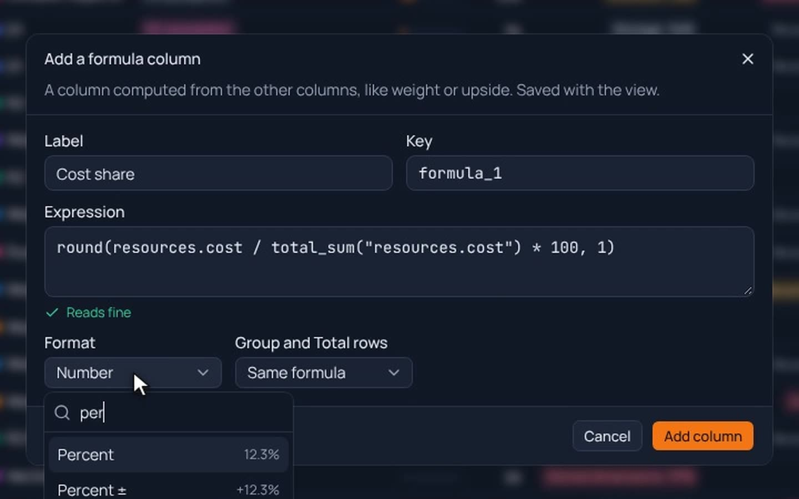
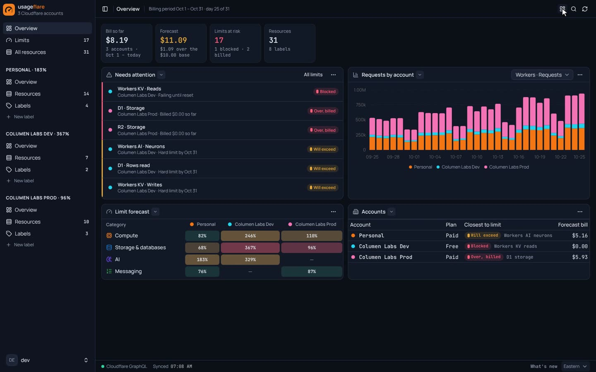

# usageflare

**Every account. Every limit. One gauge.** Usage and limits for every Cloudflare account, in one place: see what's blocked, what's already billing, and what's about to run out, before it happens. Self-hosted on Cloudflare Workers. MIT licensed.

[](https://deploy.workers.cloudflare.com/?url=https://github.com/bchoor/usageflare)

Using an AI agent? Point it at **https://usageflare.icaruslab.dev/llms.txt** and it can deploy this for you.



## Deploy in five steps

It runs as one Worker and one KV namespace in your own Cloudflare account, and only reads the accounts it watches.

1. **Deploy.** Click **Deploy to Cloudflare** above. It copies this repo to your GitHub, creates the KV namespace and deploys.
2. **Set the key.** When it asks for `SETTINGS_KEY`, paste the output of `openssl rand -base64 32`. Leave the two Access values empty for now.
3. **Lock the app.** In Zero Trust, go to Access, then Applications, and add a **Self-hosted** app for your Worker's host with two paths: `/app` and `/api`. Allow only your own email. The landing page at `/` stays public.
4. **Connect Access.** In your copy of the repo, set `ACCESS_TEAM_DOMAIN` (`<team>.cloudflareaccess.com`) and `ACCESS_AUD` (the app's audience tag) under `vars` in `wrangler.jsonc`, then commit. It redeploys on its own. Until both are set, the API answers 503.
5. **Add accounts.** [Create a read-only token](https://dash.cloudflare.com/profile/api-tokens?permissionGroupKeys=%5B%7B%22key%22%3A%22account_analytics%22%2C%22type%22%3A%22read%22%7D%2C%7B%22key%22%3A%22account_settings%22%2C%22type%22%3A%22read%22%7D%2C%7B%22key%22%3A%22workers_scripts%22%2C%22type%22%3A%22read%22%7D%2C%7B%22key%22%3A%22workers_kv_storage%22%2C%22type%22%3A%22read%22%7D%2C%7B%22key%22%3A%22workers_r2%22%2C%22type%22%3A%22read%22%7D%2C%7B%22key%22%3A%22d1%22%2C%22type%22%3A%22read%22%7D%2C%7B%22key%22%3A%22queues%22%2C%22type%22%3A%22read%22%7D%2C%7B%22key%22%3A%22billing%22%2C%22type%22%3A%22read%22%7D%5D&accountId=*&zoneId=all&name=usageflare+%28read-only%29) with the permissions already filled in, one per account. Billing Read is optional: it shows what Cloudflare actually billed beside the estimates. Open `/app`, go to Settings, then Cloudflare API tokens, and paste it.

<details>
<summary>From a terminal instead</summary>

```bash
git clone https://github.com/bchoor/usageflare && cd usageflare
bun install
bunx wrangler login
bun run build && bunx wrangler deploy                      # creates the Worker and its KV namespace
openssl rand -base64 32 | bunx wrangler secret put SETTINGS_KEY
# add the Access app (step 3), put its two values in wrangler.jsonc vars, then:
bun run build && bunx wrangler deploy
```

</details>

## What it does

- **Limits.** Every allowance across accounts (Workers, KV, D1, R2, Durable Objects, Queues, Workers AI, Containers and more), measured against your Free or Paid plan and forecast to the end of the month. Each one gets a status: Blocked, Over (billed), Will exceed, Watch or OK.
- **Projects.** Cloudflare bills by resource; labels turn resources into projects across accounts. Filter for anything without a label, tag many resources in one go, group by account and product, and save the view.
- **Your own views.** Formula columns checked as you type, plus cards, charts and widgets you can drag around and save.

| Limits | Grouping |
|---|---|
|  |  |
| **Formula columns** | **Widgets** |
|  |  |

The landing page at `/` plays the full narrated demo (`public/landing/demo.mp4`).

## Stack

One Cloudflare Worker (`wrangler.jsonc`), built with Vite and the Cloudflare Vite plugin. The UI uses the [`@columenlabs/lumen-ui`](https://www.npmjs.com/package/@columenlabs/lumen-ui) component kit. Hono serves `/api/*` (`worker/`) and the same Worker serves two pages as static assets: the public landing page at `/` (`index.html`, media in `public/landing/`) and the React SPA under `/app` (`app/index.html`, `src/`). The Worker answers every `/app/*` path with the app shell and sends the old app paths (`/limits`, `/resources`, `/a/*`) to `/app`.

| Binding | What |
|---|---|
| `KV` | The app's one KV namespace: settings and encrypted secrets |
| `ASSETS` | Static assets: the landing page and the app shell |
| `SETTINGS_KEY` (secret) | 32 random bytes, base64: the AES-GCM key for secrets in KV |
| `ACCESS_TEAM_DOMAIN`, `ACCESS_AUD` (vars) | Cloudflare Access team domain and audience tag; the Worker verifies the Access JWT on every `/api` call and answers 503 when they are empty (except on localhost) |

KV layout: `secret:<name>` → `{v, kind, label, iv, ct, last4, updatedAt, updatedBy, test}`; `accounts:v1` (10 min) → the accounts each token reaches; `usage:v2:<account>` (10 min) → that account's resources and 30 days of daily usage; `prefs:v1` → Watch threshold and plan per account; `labels:v1` → labels and which resources carry them; `seen:v1:<account>` → each listed resource's last day in its list and analytics keys (kept 90 days after it goes, longer while labelled), so a deleted resource keeps its name and a last-seen date; `view:v1:<page>` → a page's saved layout (LumenLayout view config). Secrets entered in Settings ▸ Cloudflare API tokens are encrypted with AES-GCM (the name is the additional data) before they reach KV; the API is write-only and returns only the last four characters.

## Data

`shared/catalog.ts` is the one metric model: products grouped in categories (Compute, Storage & databases, AI, Messaging), each metric with its family (requests, reads, writes, stored...), unit, kind (daily count or size) and Free/Paid allowance and price. `worker/cloudflare.ts` reads an account with the token: REST lists for resources and Worker bindings, GraphQL Analytics for usage. The UI (`src/model.ts`) judges usage against the plan: month to date on Paid, today on Free, with a forecast to month end. Anything a token can't read is named in the page, never shown as zero. A resource with usage or a label that is missing from a list that loaded is **Deleted** (last-seen date in its hover; hidden once it has no usage this billing period, back with the `Status: Deleted` filter); a listed KV, D1, R2, Queue, Hyperdrive or Vectorize resource no Worker binds is **Unbound**.

## Develop

```bash
bun install
printf 'SETTINGS_KEY=%s\n' "$(openssl rand -base64 32)" > .dev.vars
# Optional: sample data for three accounts, no token needed (localhost only)
printf 'FIXTURES=1\nACCESS_TEAM_DOMAIN=\nACCESS_AUD=\n' >> .dev.vars
bun run dev   # landing page at /, app at /app
bun run lint && bun run type-check && bun run build
```

## Deploy (this repo's instance)

Served at https://usageflare.icaruslab.dev (Worker custom domain). The landing page at `/` is public; the Cloudflare Access application covers the paths `/app` and `/api` on the custom domain, and the Worker still checks the Access JWT on every `/api` call. Its values live in `env.production` in `wrangler.jsonc`; Cloudflare Workers Builds deploys every push to `main` with the build variable `USAGEFLARE_ENV=production` (build `bun run build`, deploy `bunx wrangler deploy`). CI (`.github/workflows/ci.yml`) runs lint, typecheck and build; there are no unit tests. Releases: `lumen-ship release` every 10 merges (`.github/workflows/release.yml`, secret `ANTHROPIC_API_KEY`, repo variable `RELEASE_ON_MERGE=true`).

## License

MIT, see [LICENSE](LICENSE).
